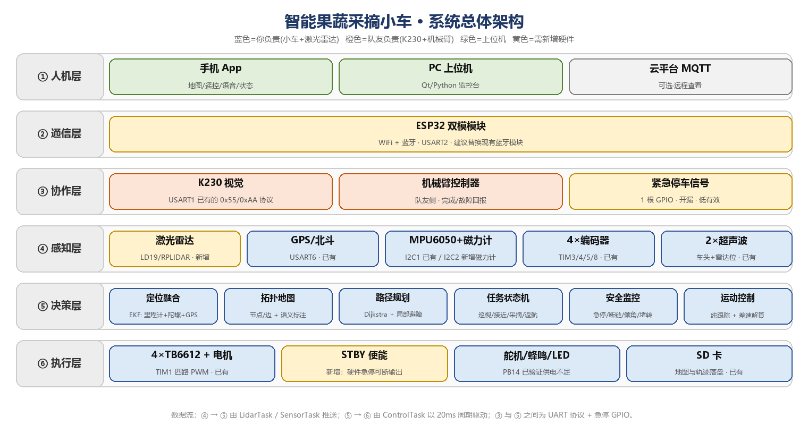
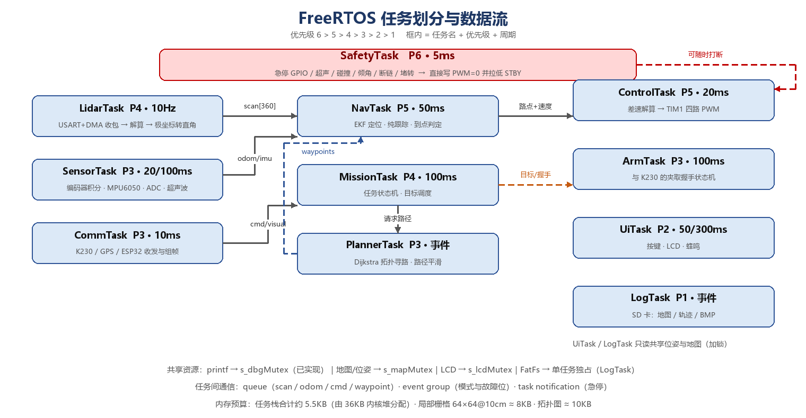
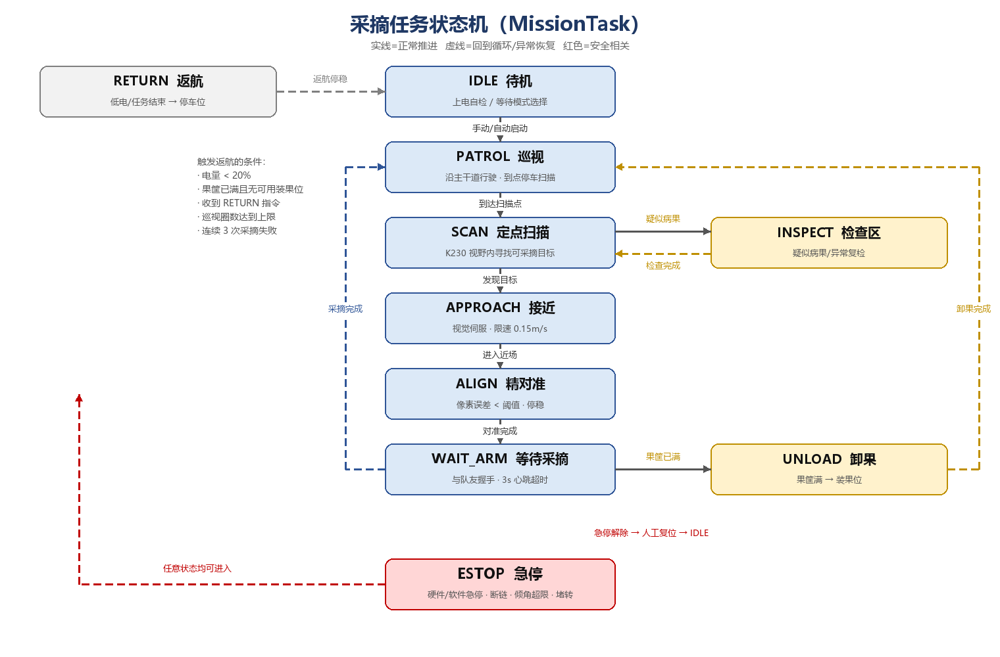
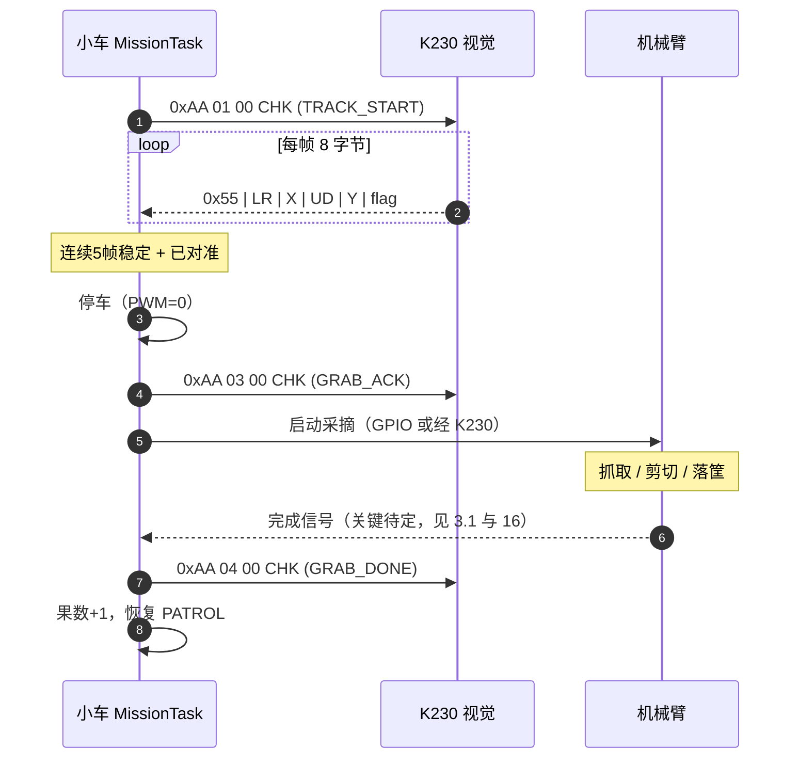
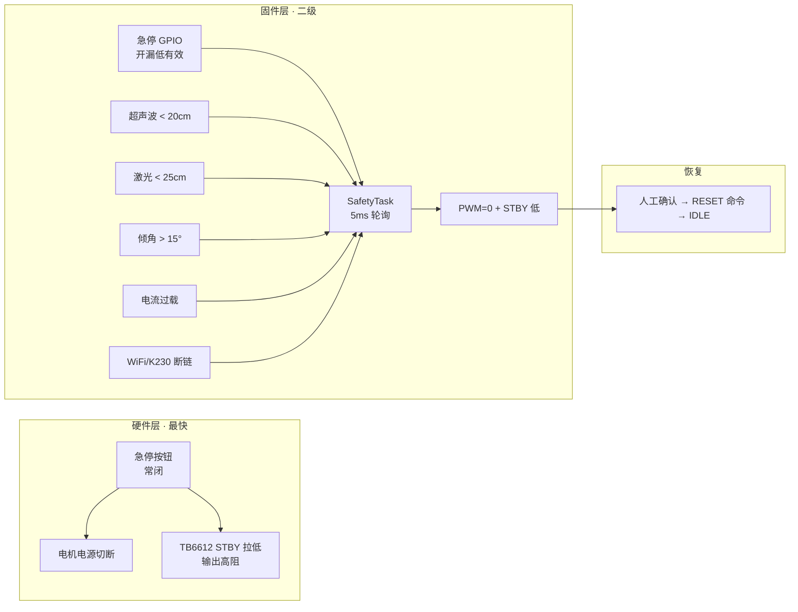
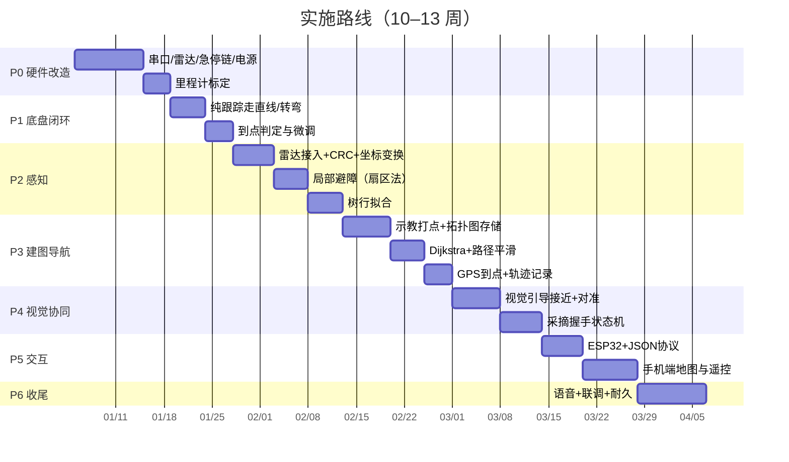

# 智能化果蔬采摘小车 · 总体方案

> **本文档只做方案设计，不改动任何工程代码。**
> 分工：**你 = 小车底盘 + 激光雷达 + 整车控制/导航**；**队友 = K230 视觉 + 机械臂**；两边通过 **UART 协议 + 1 根 GPIO（紧急停车）** 对接。
> 现有平台：STM32F407ZGT6 / 168MHz / 128KB RAM / 1MB Flash，已跑 FreeRTOS（V9.0.0，`AppTask` + `LedTask`），四驱差速 + 4 路编码器 + MPU6050 + 2 路超声波 + GPS + SD 卡 + LCD + 蓝牙 + 语音 + K230。

---

## 目录

1. [需求拆解](#一需求拆解7-个子系统)
2. [先看清家底：现有资源的余量](#二先看清家底现有资源的余量)
3. [三个必须先定下来的架构决策](#三三个必须先定下来的架构决策)
4. [系统总体架构](#四系统总体架构)
5. [硬件接口规划](#五硬件接口规划)
6. [软件架构（FreeRTOS 任务划分）](#六软件架构freertos-任务划分)
7. [定位：三层信息谁说了算](#七定位三层信息谁说了算)
8. [建图：不要做真 SLAM](#八建图不要做真-slam)
9. [路径规划与运动控制](#九路径规划与运动控制)
10. [任务状态机与采摘握手](#十任务状态机与采摘握手)
11. [与手机/PC 的通信协议](#十一与手机pc-的通信协议)
12. [语音控制](#十二语音控制)
13. [安全设计（急停链）](#十三安全设计急停链)
14. [分阶段实施计划](#十四分阶段实施计划)
15. [风险清单](#十五风险清单)
16. [需要你和队友确认的 8 件事](#十六需要你和队友确认的-8-件事)
17. [附录 A/B/C](#附录-a新增引脚分配) · [附录 C 参数默认值](#附录-c关键参数默认值)

---

## 一、需求拆解：7 个子系统

你说的那些功能，拆开其实是 7 块独立能力，**它们的技术难度和风险差别很大**，不要一起上：

| # | 子系统 | 你的需求原文 | 难度 | 风险 |
|---|---|---|---|---|
| 1 | **底盘运动控制** | —— | ★ | 低（已有，需标定） |
| 2 | **定位** | 给个 GPS 位置能到、记录路线 | ★★ | 中（GPS 精度是硬伤） |
| 3 | **建图** | 建立果园地图，标注停车位/装果位/检查区/目标点 | ★★★★ | **高（最容易做砸）** |
| 4 | **规划与导航** | 路径算法寻路、不要乱跑 | ★★★ | 中 |
| 5 | **感知避障** | 激光雷达、避障 | ★★ | 中 |
| 6 | **视觉引导协同** | 四处找果子、有视觉引导 | ★★★ | 中（依赖队友） |
| 7 | **交互层** | 蓝牙/WiFi、地图与实时信息上手机、语音 | ★★ | 低（工作量在 UI） |

**结论：真正决定项目成败的是 3（建图）和 7（交互）**，而 3 之所以危险，是因为很多人一上来就想做 SLAM。下面第三节会给出更务实的路线。

---

## 二、先看清家底：现有资源的余量

设计方案必须建立在真实约束上。下面是按你当前工程实测出来的余量。

### 2.1 引脚（详见 `老版引脚配置.md`）

| 项目 | 数量 | 说明 |
|---|---|---|
| GPIO 总数 | 114 | LQFP144 |
| 已配置 | 59 | |
| **空闲可用** | **51** | 主要富余在 PF 口（15 个）、PC0–PC5、PE0–PE6 |
| 保留 | 4 | PA13/PA14（SWD）、PH0/PH1（HSE） |

### 2.2 外设：**串口已经用满，这是最大约束**

| 外设 | 现在用于 | 能否腾出 |
|---|---|---|
| USART1 (PA9/PA10) | 调试 printf + K230 视觉 | ❌ 两者共用 |
| USART2 (PD5/PD6) | 蓝牙模块 | 可换 ESP32（同时给 WiFi） |
| USART3 (PD8/PD9) | ASRPRO 语音 | ✅ **可以腾出来** |
| USART6 (PG9/PG14) | GPS/北斗 | ❌ 必需 |
| UART4 / UART5 | **引脚被 SDIO 占死**（PC10/PC11/PC12/PD2） | ❌ 除非放弃 SD 卡 |

> **这是整个方案里第一个必须做的决定：激光雷达往哪接？** 见 3.1。

### 2.3 算力与内存

| 项目 | 现状 | 余量 |
|---|---|---|
| Flash | 63.5 KB / 1 MB | 充裕 |
| RAM | 61.9 KB / 128 KB（其中 36 KB 是 FreeRTOS 堆） | **约 66 KB**，但堆可以收窄 |
| CPU | 168 MHz Cortex-M4F | 跑 10Hz 雷达解算 + 20ms 控制没问题；**跑不动 SLAM** |
| 空闲定时器 | TIM9 / TIM10 / TIM13 / TIM14 | 够用 |
| 空闲 I2C | I2C2（PB10/PB11 或 PF0/PF1） | 可挂磁力计 |
| 空闲 SPI | SPI2（PB10/PB14/PC3 + 软件 NSS） | 见 3.1 备选方案 |

### 2.4 已知的硬件短板（会直接影响方案）

| 短板 | 影响 | 对策 |
|---|---|---|
| **舵机因供电不足被整体禁用**（`servo.c` 函数体全注释） | 无法做云台扫描 | 电源改造（5.4）后再启用；雷达本身自带旋转无需舵机 |
| **没有磁力计**，只有 MPU6050 | 航向只能靠陀螺积分，1–3°/min 漂移 | 强烈建议加 QMC5883L（几十元，I2C2） |
| **GPS 精度 ±2.5 m** | 不能用于行内定位 | 只做"到大致区域"，行内靠里程计+激光 |
| 4 路编码器装在**四轮**上（不是两轮） | 打滑时四轮读数不一致 | 左=(M1+M2)/2、右=(M3+M4)/2，并做滑移检测 |
| 无碰撞开关 | 激光有盲区（悬空枝叶/低矮藤蔓） | 建议加 2 个微动开关或碰撞条 |

---

## 三、三个必须先定下来的架构决策

### 3.1 决策一：激光雷达接哪个口？

**这是动手前必须拍板的第一件事**，因为它决定了要不要改硬件、要不要撤掉语音模块。

| 方案 | 做法 | 成本 | 优点 | 缺点 | 结论 |
|---|---|---|---|---|---|
| **A（推荐）** | **USART3 让给雷达**，语音改走手机 App 或 ESP32 | ¥0 | 零硬件改动、带宽足（230400）、调试口不受影响 | 要撤掉 ASRPRO（或改软串口） | ✅ 推荐 |
| **B** | **SPI2 + SC16IS752 双 UART 扩展** | ¥10–15 | 一次扩 2 路，语音和雷达都能留，以后还能加 | 需写约 300 行 SPI→UART 驱动，多一个中断源 | 备选（舍不得撤语音时） |
| **C** | **K230 转发雷达数据** | ¥0 | 完全不动接口 | 雷达依赖 K230 活着；USART1 要从 9600 提到 460800，调试打印要限流 | 不推荐（单点瓶颈） |
| D | 放弃 SD 卡，腾出 UART4/5 | ¥0 | 简单 | 地图/轨迹没地方存 | ❌ 不可接受 |

**方案 A 的具体理由**：
- ASRPRO 只能识别**固定词条**，口音/噪声下识别率一般，词条改动要重新训练；
- 手机 App 语音（或 ESP32 + 云端 ASR）词条随便改、识别率高，而且**和"手机/电脑控制"共用同一条 WiFi 链路**，等于白捡；
- 腾出的 USART3（APB1，42MHz）跑 230400 完全够，LD19 的 18.8 KB/s 只占 82% 带宽，留有余量。

**如果必须保留 ASRPRO**：它基本只需要"发识别结果给 MCU"，用 2 个空闲 GPIO 做 **9600 软串口 RX** 即可，CPU 占用 < 2%，不影响实时性。优先级：方案 A > 软串口 > 方案 B > 方案 C。

### 3.2 决策二：地图做到什么程度？

**强烈建议：不做 SLAM，做"示教拓扑图 + 局部栅格"。**

| 方案 | 说明 | 内存 | F407 可行性 |
|---|---|---|---|
| ❌ 真 SLAM（Cartographer 类） | 扫描匹配 + 回环优化 + 位姿图 | >200 KB | **不可能**（128KB，还要跑控制） |
| ❌ 全图栅格 A* | 整片果园栅格化后 A* | 果园 50×50m @10cm = 25 万格 ≈ 250KB+ | **不可能** |
| ✅ **拓扑图 + 局部栅格（推荐）** | 果园天然是"行 + 通道"，用几十个节点描述；车周 6.4m 小栅格只做避障 | 约 20 KB | **轻松** |

为什么拓扑图特别适合果园：

- 果园是**结构化环境**——树行、行间通道、地头，天然就是一张图，不需要栅格化；
- 节点数 ≤ 200、边数 ≤ 400，Dijkstra O(V²) 只有 4 万次运算，**毫秒级**；
- 每个节点可以直接带语义（停车位/装果位/检查区/目标点/限速/停靠朝向），你的"在地图上标注"需求天然满足；
- **断网也能跑**：路径缓存在车上，WiFi 掉了照样按节点走；
- 环境变化靠"局部栅格 + 避障"兜底，不必重建整图。

代价：换了果园布局要重新示教（遥控走一遍打点，10 分钟的事）。

### 3.3 决策三：地图和规划放在车上还是手机上？

**推荐"车上跑、手机看"的混合模式**：

| 能力 | 车上（F407） | 手机/PC |
|---|---|---|
| 拓扑图存储 | ✅ 主副本（SD 卡 + RAM） | 副本（用于显示与编辑） |
| 全局路径规划 | ✅ Dijkstra（节点少，够快） | 可选（大范围重规划） |
| 局部避障 | ✅ 必须（实时） | ❌ |
| 地图显示/编辑 | ❌（LCD 太小） | ✅ 主界面 |
| 语义点增删 | 接收下行指令后落库 | ✅ 用户操作 |
| 轨迹回放 | SD 卡存原始点 | ✅ 绘制 |

这样**断链时车仍能自主完成巡视**，符合你"不要乱跑"的要求。

---

## 四、系统总体架构



> 图见 [`图/图1_系统架构.png`](图/图1_系统架构.png)。六层：人机 / 通信 / 协作 / 感知 / 决策 / 执行。

---

## 五、硬件接口规划

### 5.1 激光雷达选型

| 型号 | 接口 | 波特率 | 量程 | 角分辨率 | 价格 | 评价 |
|---|---|---|---|---|---|---|
| **LD19 / D300** | UART TTL | 230400 | 0.02–12 m | ~0.5° | ~¥200 | ✅ **首选**，便宜够用 |
| LD06 | UART TTL | 230400 | 0.02–12 m | 0.5° | ~¥180 | 与 LD19 基本同协议 |
| RPLIDAR A1M8 | UART | 115200 | 0.15–12 m | ~1° | ~¥400 | 生态最好（有官方 SDK），但 115200 偏慢 |
| RPLIDAR C1 | UART | 460800 | 0.05–12 m | 0.5° | ~¥600 | 更好，但需 460800 支持 |

**LD19 协议要点**（实现时照这个写解析器）：

```
每包 47 字节：
 [0]      0x54                     帧头
 [1]      VerLen                  低 5 位 = 本包点数(通常 12)
 [2..3]   Speed                   转速(度/秒), 小端
 [4..5]   StartAngle              起始角, 0.01° 单位, 小端
 [6..41]  12 × (距离低, 距离高, 强度)   距离单位 mm
 [42..43] EndAngle                结束角, 0.01°
 [44..45] Timestamp               毫秒
 [46]     CRC8                    对 [0..45] 计算, 多项式 0x4D, 初值 0
```

带宽核算：10 Hz × 约 4500 点/s ≈ 400 包/s × 47 B ≈ **18.8 KB/s**，230400 8N1 上限 23.0 KB/s → 占用 82%，安全。

**接入实现建议**：
- UART + **DMA 循环缓冲（2 KB）**，用 **IDLE 中断**触发批处理（和现有 `gps.c` 的 DMA 收法一致，可以照抄）；
- 解析在 `LidarTask`（优先级 4，10 Hz）里做，**不要在中断里做坐标变换**；
- 每帧输出两种数据：① 360 个扇区的最小距离（给避障用，360 B）；② 前方/左右/右方的特征点集（给树行拟合用）。

### 5.2 新增引脚分配（在你现有空闲脚里选）

| 用途 | 引脚 | 模式 | 说明 |
|---|---|---|---|
| 激光雷达 TX/RX（方案 A） | **PD8 / PD9** | 复用 AF7 (USART3) | 直接复用现有语音口 |
| 急停信号（与 K230） | **PE0** | 输入、上拉、EXTI | 开漏线，低有效，见 5.4 |
| 急停信号（备用第二线） | PE1 | 输入、上拉、EXTI | 若队友能提供独立方向 |
| 电机驱动 STBY（新增） | **PB1** | 推挽输出、初始低 | 硬件急停直接拉低断输出 |
| 磁力计 I2C2 | **PB10 / PB11** | 复用 AF4、开漏、上拉 | QMC5883L / HMC5883L |
| 碰撞开关 1（前左） | PE4 | 输入、上拉 | 可选 |
| 碰撞开关 2（前右） | PE5 | 输入、上拉 | 可选 |
| 电流检测（ADC） | **PC0** | 模拟输入 | ADC1/2/3_IN10，电机总电流 |
| 蜂鸣/状态灯（可选） | PE15 | 推挽输出 | 急停指示 |

> 若选方案 B（SPI2 + SC16IS752）：PB10 改作 SPI2_SCK、PB14 作 MISO、PC3 作 MOSI、PE15 作 NSS，磁力计改挂 **PF0/PF1**（I2C2 的另一组引脚）。

### 5.3 K230 协议：沿用 + 小幅扩展

你现有的协议已经很规范，**不要推翻**，只加指令：

**K230 → 主控（保持原样，8 字节无校验）**
```
0x55 | LR | X高 X低 | UD | Y高 Y低 | flag
```
建议新增 2 个字段（利用 `flag` 的扩展位或加一帧）以支持"果实类别/成熟度/深度估计"，但要和队友商量——**改协议要两边同时改**。

**主控 → K230（保持原样，变长带 XOR 校验）**
```
0xAA | CMD | LEN | payload[LEN] | CHK
```

| CMD | 名称 | 用途 |
|---|---|---|
| 0x01/0x02 | TRACK_START / STOP | 已有 |
| 0x03 | GRAB_ACK | 已有：已停车，可以动臂 |
| 0x04 | GRAB_DONE | 已有：采摘结束 |
| 0x05 | RECALIB | 已有 |
| 0x06 | HEARTBEAT | 已有 |
| 0x07 | SET_SPEED | 已有 |
| **0x08（新增建议）** | **APPROACH_HINT** | 主控告诉 K230 "我已靠近到 xx cm，请缩小搜索范围" |
| **0x09（新增建议）** | **ROI_SET** | 指定只在该矩形 ROI 内找目标，减少误识别 |
| **0x0A（新增建议）** | **ABORT** | 主控要求 K230 放弃当前目标（超距/超时/被判无效） |

### 5.4 急停 GPIO 规范（**最容易出事的地方**）

你只给 1 根线，那就必须严格定义电气与语义，否则可能烧口或抖动误停。

**电气要求**

```
       3.3V            3.3V
        │ 10k           │ 10k
        ├─────┬─────────┤
        │     │         │
   F407 PE0 ──┴── 线 ──┴── K230 GPIO（开漏）
```

- **两端都必须配成开漏输出**（或一端开漏、一端输入），**严禁两边都推挽**——一边拉高一边拉低会直接烧口；
- 两端各 10 kΩ 上拉到 3.3 V；
- 线长 ≤ 50 cm 时加 100 nF 到地做 RC 去抖（τ≈1 ms）。

**软件语义**

| 项 | 规定 |
|---|---|
| 有效电平 | **低电平 = 急停请求** |
| 去抖 | 连续 3 次 × 5 ms 采样为低才确认（15 ms） |
| 最小脉宽 | 拉低必须保持 ≥ 10 ms，否则忽略 |
| 谁能拉低 | 双方都可以（线与） |
| 谁能释放 | 只有"确认安全"的一方才释放；**且必须双方都释放** |
| 恢复 | 不允许自动恢复。需上位机下发 `RESET` 或按物理按键复位，避免抖动导致反复启停 |
| 响应时间 | F407 检测到后 **≤ 100 ms** 让 PWM 归零并拉低 STBY |

**硬件级安全（强烈建议加）**

急停不能只靠固件。建议：

```
电池 ──[ 急停按钮(常闭) ]──[ 保险丝 ]──┬── 电机电源
                                        └── TB6612 STBY（经 10k 下拉）
```

这样按下按钮时，即使 MCU 死机，电机也立刻断电/高阻。固件层的急停只是二级措施。

> 你现在的 `motor.c` **没有控制 STBY**，所以驱动板一直处于使能状态。建议补一个 GPIO 控 STBY，这是成本最低、收益最大的一处安全改造。

### 5.5 电源预算（**第二大的风险**）

现状：舵机因为供电不足被整体禁用（`servo.c` 全部注释）——说明现在的电源方案已经很紧。

| 负载 | 电压 | 典型电流 | 峰值 |
|---|---|---|---|
| 4× 直流减速电机 | 12 V | 0.8 A | 3–4 A（堵转） |
| STM32 + 传感器 + SD + LCD | 3.3/5 V | 0.2 A | 0.3 A |
| **激光雷达** | 5 V | 0.25 A | 0.4 A |
| **机械臂舵机 ×N** | 6–7.4 V | 0.5 A | **2–3 A** |
| 无线模块 | 3.3 V | 0.1 A | 0.5 A（发射瞬间） |

**建议的供电架构**：

```
12V 锂电 ─┬─ 电机驱动（直供，加 470µF 电解 + 100nF）
          ├─ DC-DC 5V/3A ── 雷达、逻辑、无线
          └─ DC-DC 6V/5A ── 机械臂舵机（单独一路，避免舵机启动拉垮逻辑电源）
共地，舵机地与逻辑地在电源入口单点汇合
```

**必须和队友对齐的**：机械臂舵机是**你供电**还是**队友自带电池**？如果是你供电，电池和 DC-DC 要重新算，这可能是整个项目最容易翻车的地方。

---

## 六、软件架构（FreeRTOS 任务划分）

### 6.1 任务表



| 任务 | 优先级 | 栈(字) | 周期 | 职责 | 备注 |
|---|---|---|---|---|---|
| `SafetyTask` | **6** | 256 | 5 ms | 急停 GPIO、超声、碰撞、倾角、断链、堵转检测；**直接写 PWM=0 + 拉低 STBY** | 最高优先级，只做"刹车" |
| `ControlTask` | 5 | 384 | **20 ms** | 差速解算、4 路 PWM、编码器积分、里程计 | 硬实时 |
| `NavTask` | 5 | 768 | 50 ms | EKF 定位、纯跟踪、到点判定、局部避障 | 复用现有 `A*` 不需要 |
| `LidarTask` | 4 | 512 | 10 Hz | UART+DMA 收包、CRC 校验、极坐标转直角、扇区最小距离 | 新增 |
| `MissionTask` | 4 | 512 | 100 ms | 任务状态机（图2）、目标调度、与 K230 握手 | 新增 |
| `PlannerTask` | 3 | 1024 | 事件触发 | 拓扑图 Dijkstra、路径平滑、缓存 | 事件驱动，平时阻塞 |
| `CommTask` | 3 | 512 | 10 ms / 事件 | K230、GPS、ESP32 收发与组帧、JSON 打包 | 复用现有 GPS/K230 逻辑 |
| `UiTask` | 2 | 512 | 50/300 ms | 按键、LCD、蜂鸣 | 现有 `UiTask` 改造 |
| `LogTask` | 1 | 768 | 事件 | SD 卡：地图、轨迹、BMP、上位机请求的文件 | FatFs 单任务独占 |
| IDLE / Tmr | 0 / 31 | — | — | 空闲、软件定时器 | 已有 |

> 栈合计约 **5.2 KB**，全部从现有 36 KB 内核堆里分配，**不用改链接脚本**。

### 6.2 任务间通信

| 对象 | 类型 | 生产者 → 消费者 |
|---|---|---|
| `q_scan` | Queue(1, 360B) | LidarTask → NavTask |
| `q_odom` | Queue(4, 16B) | ControlTask → NavTask / LogTask |
| `q_cmd` | Queue(8, 32B) | CommTask → MissionTask |
| `q_waypoint` | Queue(2, 4×8B) | PlannerTask → NavTask |
| `s_mapMutex` | Mutex | 地图/位姿读写 |
| `s_lcdMutex` | Mutex | LCD 独占 |
| `s_dbgMutex` | Mutex | printf（**已实现**） |
| `g_mode` / `g_err` | EventGroup | 状态位广播 |
| 急停 | **Task Notification** | SafetyTask → 各任务（最快） |

### 6.3 分层：完全沿用你现在的结构

```
MY (app)       main.c / AppTask
  ↓
BSP            bsp.c            ← 新增 lidar/estop/mag 初始化
  ↓
Mid (算法)     location.c       ← 扩成 nav.c（EKF + 纯跟踪）
               map_graph.c      ← 新增：拓扑图 + Dijkstra
               planner.c        ← 新增：局部避障
  ↓
Program (模块) gps.c / K230.c / bluetooth.c / asrpro.c
               lidar.c          ← 新增
               estop.c          ← 新增
               uart_host.c      ← 新增：与 ESP32 的协议
  ↓
Drive (驱动)   motor.c / encoder.c / mpu6050.c / ultrasonic.c ...
```

**新增文件清单**：`Program/Source/lidar.c`、`Program/Source/estop.c`、`Program/Source/uart_host.c`、`Mid/Src/map_graph.c`、`Mid/Src/planner.c`、`Mid/Src/nav.c`（由 `location.c` 扩展）。
**要改的现有文件**：`bsp.c`（初始化顺序）、`main.c`（任务创建）、`K230.c`（新指令）、`menu.c`（地图页/状态页）。

### 6.4 内存预算

| 项目 | 大小 | 说明 |
|---|---|---|
| FreeRTOS 堆（现有） | 36 KB | 可收窄到 24 KB 给地图让位 |
| 任务栈合计 | ~5.2 KB | 从堆里出 |
| 拓扑图节点 | 200 × 32 B = 6.4 KB | |
| 拓扑图边 | 400 × 12 B = 4.8 KB | |
| 局部栅格 64×64 @10 cm | 4 KB 占据 + 4 KB 代价 | 车周 6.4 m |
| 激光帧缓冲 | 360 B + 特征点 512 B | |
| 路径缓存 | 64 路点 × 8 B = 512 B | |
| **合计新增** | **约 20 KB** | 当前余量 66 KB，**够** |

---

## 七、定位：三层信息谁说了算

这是"不乱跑"的基础。三层信息按可信度分工，不要指望任何单一传感器。

| 信息源 | 精度 | 频率 | 用途 | 不能用于 |
|---|---|---|---|---|
| **编码器里程计** | 1–3 % 距离误差 | 20 ms | 短时推算、到点判定 | 长时间（累积误差） |
| **MPU6050 陀螺** | 短时好，漂移 1–3°/min | 200 ms | 航向短时平滑 | 长时间航向 |
| **磁力计（建议新增）** | ±2–5°（有铁磁干扰时更差） | 50 ms | 航向绝对参考 | 电机旁干扰大 |
| **GPS/北斗** | ±2.5 m CEP，1 Hz | 1 s | 大范围路点、轨迹记录 | **行内定位、航向** |
| **激光雷达** | 相对 2–5 cm | 10 Hz | 局部避障、树行相对定位 | 全局绝对位置 |

### 7.1 坐标系

```
世界系 W：原点 = 上电位置（或示教起点），x 向东，y 向北，θ 逆时针
车体系 B：x 向前，y 向左，原点 = 后轴中心
雷达系 L：安装偏移 (dx, dy, dθ)，标定后固定
相机系 C：（队友侧）由 K230 自行处理，只输出像素偏差
```

### 7.2 里程计标定（第一周就要做）

差速模型：

```
v_L = (脉冲_M1 + 脉冲_M2) / 2 / K     [m/s]
v_R = (脉冲_M3 + 脉冲_M4) / 2 / K
v   = (v_L + v_R) / 2
ω   = (v_R - v_L) / W
```

标定步骤（用两次迭代就够准）：
1. **K（脉冲/米）**：直行 3 m，读四轮总脉冲，`K = 脉冲/3`；
2. **W（轮距）**：原地转 10 圈（10×360°），读左右轮差 `Δs`，`W = Δs/(2π×10)`；
3. 重复一遍，用第 2 次的 K、W 再测一次验证，误差 < 2% 即可。

### 7.3 融合（EKF，状态 5 维）

```
x = [x, y, θ, v, ω]
预测：里程计 + 陀螺
更新：磁力计（θ）、GPS（x,y，权重极低）、激光树行偏移（横向 x）
```

**关键提醒**：进树行后 GPS 的 x/y 会跳变几米，**必须靠 GPS 的 HDOP 和卫星数做门限**（你现有 `navlog.c` 里已经有 HDOP>3.0 过滤，思路可以复用）。

### 7.4 GPS 的真实用法

- ✅ 用于"开到东边第 3 行地头"这种**十米级**目标；
- ✅ 用于记录路线（你需求里的"记录路线"）；
- ❌ **不能**用于"停到装果位正前方 ±10 cm"。

所以装果位/停车位的精确停靠，必须靠**里程计 + 激光标志物**或**地面标记**（见 8.3）。

---

## 八、建图：不要做真 SLAM

### 8.1 三层地图

| 层 | 内容 | 存储 | 谁用 |
|---|---|---|---|
| **拓扑层** | 节点（路口/行首/行尾/停车位/装果位/检查区/目标点）+ 边（长度/方向/限速） | `map_graph.c`，SD 卡一份 | PlannerTask |
| **语义层** | 每个节点的属性：类型、停靠朝向、可用动作、容量 | 同上（挂在节点结构里） | MissionTask |
| **局部栅格层** | 车周 6.4 m×6.4 m，10 cm/格，8 位占据概率 | RAM，滚动更新 | NavTask（避障） |

节点结构（32 B）：

```c
typedef struct {
    int16_t  x, y;        // 世界坐标, cm
    int16_t  heading;     // 期望停靠朝向, 0.1°
    uint8_t  type;        // PARK / UNLOAD / INSPECT / TARGET / WAYPOINT / JUNCTION
    uint8_t  flags;       // 双向/单向/限速等级
    uint8_t  stopOffset;  // 停靠时距节点中心的偏移, cm
    uint8_t  reserved;
    uint16_t edgeHead;    // 出边索引
    uint16_t id;
    uint8_t  name[12];    // 便于调试
    uint8_t  extra[4];
} GraphNode_t;
```

### 8.2 建图流程（示教）

```
① 遥控（蓝牙/手机）把车从起点开到果园各条通道
② 每到一个关键位置按 KEY4 打一个节点，并在 LCD/手机上选类型
   （或按固定 1 m 间隔自动打点）
③ 每个节点自动记录：(x, y, θ) 来自里程计+陀螺, GPS 经纬度仅作备注
④ 车自己识别"转弯/掉头"事件，自动插入 JUNCTION 节点
⑤ 结束时一键导出到 SD 卡：0:/CARMAP/MAP.BIN + MAP.JSON
⑥ 可通过 WiFi 上传到手机，用于显示与二次编辑
```

### 8.3 精确停靠的工程做法（重要）

拓扑节点只给"大致位置"，但装果位需要厘米级。三种办法，按成本排序：

| 办法 | 精度 | 成本 | 说明 |
|---|---|---|---|
| **地面标记**（AprilTag / 色块 / 磁条） | ±2 cm | 极低 | 推荐！车头超声波+激光找到标记即减速对准 |
| 里程计二次逼近 | ±5–10 cm | 0 | 到节点后低速"最后 50 cm"用编码器闭环 |
| 激光特征拟合（墙角/立柱） | ±3 cm | 0 | 需要环境有可辨识几何特征 |

**建议用 AprilTag / 色块**：打印一张 A4 贴在地上，摄像头或激光都能用，成本几毛钱，精度比 GPS 高两个数量级。

### 8.4 地图文件格式（SD 卡）

```
0:/CARMAP/MAP.BIN    二进制：magic + 版本 + 节点数 + 节点数组 + 边数组 + CRC32
0:/CARMAP/MAP.JSON   可读副本，给上位机显示与编辑用
0:/CARMAP/TRACK.CSV  现有轨迹记录（复用 navlog.c）
```

上电流程：读 MAP.BIN → CRC 校验 → 失败则回退 MAP.JSON → 再失败则进入"无地图模式"（只允许遥控）。

---

## 九、路径规划与运动控制

### 9.1 全局：拓扑 Dijkstra

```c
// 伪代码
dist[] = INF; prev[] = -1; dist[start] = 0;
for (i = 0; i < N; i++) {
    u = 未访问中 dist 最小者;     // N <= 200，线性扫描足够
    for (每条 u 的出边 e) {
        if (dist[u] + e->len < dist[e->to]) { dist[e->to] = dist[u] + e->len; prev[e->to] = u; }
    }
}
```

- N=200 时约 4 万次比较，**< 1 ms**；
- 加 A* 启发（欧氏距离）可以更快，但不是必需；
- 输出：节点序列 → 用 Catmull-Rom 或二次 B 样条平滑成连续路点（每 10 cm 一个点）。

### 9.2 局部：避障

两级策略，简单可靠优先：

| 层级 | 触发 | 动作 |
|---|---|---|
| **急停级** | 前方 ±20° 内 < 25 cm（激光）或超声波 < 20 cm | 立即停车，等 1 s 重测；连续 3 次仍近 → 上报"受阻" |
| **绕行级** | 前方 ±45° 内 < 60 cm | 减速至 0.1 m/s；若一侧空闲 > 1.2 m，则偏置目标点绕行 |
| **降级级** | 激光数据缺失/异常 > 200 ms | 只用超声波，限速 0.15 m/s，并上报故障位 |

> 不要一上来写 DWA/VFH+，先用"扇区最小距离 + 阈值"做出来，跑通再升级。

### 9.3 纯跟踪（Pure Pursuit）

```
Ld = clamp(k_v * v + L_min, 0.35 m, 1.2 m)      k_v ≈ 1.0, L_min = 0.35
在路径上找距离车 ≥ Ld 的目标点 P
α = atan2(P.y_local, P.x_local)
ω = 2 * v * sin(α) / Ld
v_L = v - ω*W/2 ;  v_R = v + ω*W/2
```

- 巡视速度 **0.25–0.3 m/s**，接近果实时 **0.1–0.15 m/s**；
- 到点判定：`dist < 12 cm 且 |Δθ| < 8°`，否则低速微调 3 次后放弃。

### 9.4 行间行走（果园最实用的一招）

在树行里，**不要用全局定位**，用激光做"走廊拟合"：

```
① 取激光在车身左右两侧 ±(60°..120°) 范围内的点
② 右/左各做最小二乘（或 RANSAC）拟合一条直线
③ 计算：横向偏移 e = (d_left - d_right)/2
        航向偏差 φ = (θ_left + θ_right)/2
④ PD 控制：ω = Kp*e + Kd*φ        （Kp ≈ 0.8, Kd ≈ 0.35）
⑤ 同时用中线限速：两侧都 < 0.5 m 时限速 0.12 m/s
```

这套方法在果园里比任何 SLAM 都稳，因为它**只依赖局部相对几何**，不受里程计漂移影响。实现量约 200 行。

---

## 十、任务状态机与采摘握手



### 10.1 状态迁移表

| 当前 | 事件 | 下一状态 | 动作 |
|---|---|---|---|
| IDLE | 手动/自动启动 | PATROL | 加载地图、定位、规划到第一个扫描点 |
| PATROL | 到达扫描点且停稳 | SCAN | 通知 K230 `TRACK_START` |
| SCAN | K230 报告稳定目标（连续 5 帧） | APPROACH | 记录目标，限速 |
| SCAN | 3 s 无目标 | PATROL | 通知 K230 `TRACK_STOP`，去下一点 |
| SCAN | 目标被判"疑似病果" | INSPECT | 前往检查区 |
| APPROACH | 目标进入近场（y < 阈值） | ALIGN | 减速到 0.1 m/s |
| ALIGN | 像素偏差 < 阈值且已停稳 | WAIT_ARM | 停车，发 `GRAB_ACK` |
| ALIGN | 15 s 未对准 | PATROL | 记 1 次失败 |
| WAIT_ARM | 收到完成信号 | PATROL | 果数 +1，发 `GRAB_DONE` |
| WAIT_ARM | 3 s 超时 | WAIT_ARM | 重发 `GRAB_ACK`（最多 1 次） |
| WAIT_ARM | 重试后仍超时 | PATROL | 记失败，上报 |
| WAIT_ARM | 果筐满 | UNLOAD | 规划到装果位 |
| UNLOAD | 卸果完成（人工/机械确认） | PATROL | 果数清零 |
| INSPECT | 检查完成 | SCAN | 回到原扫描点 |
| 任意 | 低电/任务结束/连续 3 次失败 | RETURN | 规划到停车位 |
| 任意 | 急停（GPIO/软件/断链/倾角） | ESTOP | PWM=0 + STBY 低 |

### 10.2 采摘握手时序



**这里有一个必须和队友敲定的接口问题**：机械臂"完成/故障"怎么回传给小车？
- 若机械臂挂 K230 → 用 K230 的 CMD 通道回（最省线）
- 若机械臂独立 MCU → 需要 1 根 GPIO（完成脉冲）或占用一个串口
- 若是纯舵机时序（开环） → 只能靠"发命令后固定延时 + 视觉复检确认"

---

## 十一、与手机/PC 的通信协议

### 11.1 物理层

- **ESP32 模块**（替换现有蓝牙模块）：同时提供 **WiFi + 蓝牙**，接 USART2；
- 工作模式：AP 模式（手机直连）或 STA 模式（连果园路由，可多车）；
- 传输：**TCP 长连接 + JSON Lines**（每行一个 JSON，简单好调）；也可以直接上 MQTT。

### 11.2 上行（车 → 手机/PC）

**遥测，10 Hz**：

```json
{"t":123456,"x":1.234,"y":5.678,"h":87.3,"v":0.28,
 "mode":"PATROL","bat":11.8,"gps":[30.123456,120.123456,3],
 "obs":{"front":0.85,"left":1.2,"right":0.4},
 "basket":3,"err":0}
```

字段：`t` 毫秒时间戳、`x/y/h` 位姿、`v` 速度、`mode` 状态、`bat` 电压、`gps` 经纬度+星数、`obs` 三方向最近障碍、`basket` 已采果数、`err` 故障位图。

**事件上报（按需）**：

```json
{"ev":"TARGET_FOUND","id":17,"x":2.1,"y":4.4}
{"ev":"PICK_OK","count":4}
{"ev":"PICK_FAIL","reason":"ARM_TIMEOUT"}
{"ev":"ESTOP","src":"GPIO"}
{"ev":"LOW_BAT","v":10.9}
```

**地图同步**：只在连接建立时全量下发一次（MAP.JSON，约 8–20 KB），之后按差分。分块用：

```json
{"map":"meta","nodes":120,"edges":203,"crc":"A1B2C3D4"}
{"map":"chunk","seq":0,"data":"<base64 512B>"}
```

### 11.3 下行（手机/PC → 车）

```json
{"cmd":"goto","x":3.5,"y":8.0}          // 去指定坐标
{"cmd":"goto_node","id":17}              // 去指定节点
{"cmd":"mode","v":"PATROL"}              // 切模式
{"cmd":"teach","act":"add","type":"PARK","x":0,"y":0}
{"cmd":"teach","act":"del","id":12}
{"cmd":"speed","v":0.3}
{"cmd":"estop"}                          // 软急停
{"cmd":"reset"}                          // 复位（需人工确认）
{"cmd":"voice","text":"去装果位"}         // 语音识别结果
{"cmd":"ask","what":"map"}               // 请求重新下发地图
```

### 11.4 带宽核算

- 遥测 10 Hz × 250 B = **2.5 KB/s**；
- 一个 64×64 的栅格位图 = 512 B，1 Hz 上传 = 0.5 KB/s；
- 合计 < 4 KB/s → **WiFi 完全无压力**，蓝牙 SPP（约 20 KB/s）也够，但蓝牙连接受限距离更短。

> 提醒：2.4 GHz 在果园里被树叶衰减严重，实测空旷 50 m、树行间可能只有 20–30 m。大面积果园建议 **4G 模块**或**WiFi 中继**。

---

## 十二、语音控制

两条路，按第三节的串口决策走：

| 方案 | 实现 | 识别率 | 词条更改 | 成本 |
|---|---|---|---|---|
| **A（推荐）** | 手机 App 语音 → 云端/本地 ASR → 转成 `{"cmd":"voice","text":"..."}` 走 WiFi | 高 | 随时改 | ¥0 |
| B | 保留 ASRPRO（USART3 或软串口） | 中 | 需重新训练 | 已有 |

**统一指令集**（两种方案共用同一套解析）：

| 语音 | 动作 |
|---|---|
| 前进 / 后退 / 左转 / 右转 / 停 | 手动速度控制（仅 TELEOP 模式） |
| 开始巡视 / 果园巡逻 | `mode=PATROL` |
| 回停车位 | `goto_node(PARK)` |
| 去装果位 | `goto_node(UNLOAD)` |
| 去检查区 | `goto_node(INSPECT)` |
| 去目标点 N | `goto_node(N)` |
| 急停 / 停车 | 软急停 |
| 继续 | 复位并恢复上一模式 |
| 记录当前位置 | `teach add` |
| 电量多少 / 在哪 | 语音播报（可选 TTS） |

**设计要点**：语音只做"意图识别"，实际执行全部落到同一个命令解析器——**蓝牙、WiFi、语音、按键四条路最终调用同一个 `Command_Exec()`**，这样不会出现"某种控制方式下行为不一致"的经典 bug。

---

## 十三、安全设计（急停链）



### 安全参数默认值

| 参数 | 默认 | 说明 |
|---|---|---|
| 巡视最高速 | 0.30 m/s | |
| 接近果实时 | 0.15 m/s | |
| 树行内 | 0.12 m/s | |
| 超声波停车距离 | 20 cm | 车头 + 雷达位 |
| 激光急停距离 | 25 cm | 前方 ±20° |
| 激光减速距离 | 60 cm | 前方 ±45° |
| 倾角停车阈值 | 15° | MPU6050 俯仰/横滚 |
| 电机过流 | 3 A | 采样电阻 + ADC |
| WiFi 断链停车 | 3 s | 仅在遥控/远程模式 |
| K230 断链停车 | 1 s | 仅在 VISION 模式 |
| 看门狗 | IWDG 1 s | 各任务喂狗计数 |
| 急停响应 | ≤ 100 ms | 从检测到 PWM=0 |

**必须记住的一条**：`SafetyTask` 是唯一有权直接写电机的任务（它只做"归零"），`ControlTask` 写电机前要先看 `g_err` 里有没有急停位。**只有一个写者能保证不乱**。

---

## 十四、分阶段实施计划



### 阶段验收标准（每阶段必须能量化）

| 阶段 | 验收标准 |
|---|---|
| P0 | 雷达 10 Hz 稳定出点；急停按钮按下后电机 100 ms 内断电；里程计直行 5 m 误差 < 5 cm |
| P1 | 直线 5 m 横向偏差 < 8 cm；90° 转弯后航向误差 < 5°；到点判定 < 10 cm |
| P2 | 前方 30 cm 放障碍物能停车；1.2 m 宽通道能通过不碰；树行内横向偏差 < 10 cm |
| P3 | 示教 20 个节点；任意两点间能自动到达；断网后仍能完成一次巡视 |
| P4 | 视觉引导接近成功率 > 70%；采摘握手超时能正确恢复、不卡死 |
| P5 | 手机端 10 Hz 刷新不丢帧；地图能显示与标注；遥控延迟 < 200 ms |
| P6 | 连续巡视 30 min 无复位、无卡死；急停测试 20 次全部正确 |

---

## 十五、风险清单

| # | 风险 | 概率 | 影响 | 对策 |
|---|---|---|---|---|
| 1 | **电源不够**（舵机已被迫禁用，还要加雷达+机械臂） | 高 | 致命 | 先做 5.4 的供电改造，单独 6V 给舵机 |
| 2 | **串口不够**导致方案推不动 | 中 | 高 | 第三节先拍板（推荐方案 A） |
| 3 | 2D 激光看不到悬空枝叶/低矮藤蔓 | 高 | 中 | 加碰撞条 + 超声波补盲；限速 |
| 4 | GPS 精度不足，到点不准 | 高 | 中 | 用地面 AprilTag/色块做末端精定位 |
| 5 | 无磁力计导致航向漂移 | 中 | 中 | 加 QMC5883L（¥20）；或依赖 GPS 航向 + 树行拟合 |
| 6 | K230 视觉逆光/遮挡失效 | 高 | 中 | "找不到就继续走"，绝不允许原地卡死（状态机必须超时） |
| 7 | 地面打滑导致里程计漂移 | 中 | 中 | 四轮平均 + 滑移检测 + 树行纠偏 |
| 8 | 队友接口未定（机械臂完成信号） | 高 | 高 | **第 16 节第 2 条，尽早定** |
| 9 | 一次性把任务拆太细，调试困难 | 中 | 中 | 按第十四节分阶段，每阶段单独验收 |
| 10 | WiFi 在树丛中距离不足 | 中 | 中 | 4G 模块 / 中继 / 降低频率 |

---

## 十六、需要你和队友确认的 8 件事

> 这 8 条不定下来，方案里的数字都只能算"建议值"。

1. **激光雷达型号定了吗？** 接口电压、波特率、供电电流（LD19 是 5V/230400）。
2. **机械臂的"完成/故障"怎么回传给小车？** 挂 K230，还是独立 MCU 加一根 GPIO？（决定协议，也决定要不要多占一个串口）
3. **能不能撤掉 ASRPRO 语音模块？** 如果必须保留，就要接受"软串口"或"加 SPI→UART 芯片"。
4. **电池容量与续航要求？** 现在舵机都带不动，加雷达和机械臂后是否换电池/加 DC-DC？
5. **果园现场条件**：行距/株距多少？地面（土路/草地/有坡）？有无水泥柱/铁丝？
6. **作业节拍**：一遍巡视允许多久？果实密度大概多少？（决定扫描点间距与停留时间）
7. **上位机用手机还是电脑？** 决定 UI 技术栈（Android / 微信小程序 / PC Qt）。
8. **是否要求夜间作业？** 需要补光，K230 的曝光和激光的可见性都会受影响。

---

## 附录 A：新增引脚分配

| 功能 | 引脚 | 模式 | 备注 |
|---|---|---|---|
| 激光雷达 TX/RX | PD8 / PD9 | AF7 (USART3) | 方案 A：原语音口 |
| 急停信号 | PE0 | 输入上拉 + EXTI | 开漏、低有效、RC 去抖 |
| 急停备用线 | PE1 | 输入上拉 + EXTI | 可选 |
| 电机 STBY | PB1 | 推挽输出（初低） | 硬件急停用 |
| 磁力计 SCL/SDA | PB10 / PB11 | AF4 开漏上拉 | I2C2，QMC5883L |
| 碰撞开关 ×2 | PE4 / PE5 | 输入上拉 | 可选 |
| 电流检测 | PC0 | 模拟输入 | ADC 通道 |
| 状态指示灯 | PE15 | 推挽输出 | 可选 |

> 详细引脚全表见 [`老版引脚配置.md`](老版引脚配置.md)。

## 附录 B：新增/扩展的源码文件

| 文件 | 类型 | 内容 |
|---|---|---|
| `Program/Source/lidar.c` + `lidar.h` | 新增 | LD19/RPLIDAR 解析、DMA 收包、CRC、扇区压缩 |
| `Program/Source/estop.c` + `estop.h` | 新增 | 急停 GPIO 去抖、状态机、恢复流程 |
| `Program/Source/uart_host.c` + `uart_host.h` | 新增 | 与 ESP32 的帧协议、JSON 打包 |
| `Mid/Src/map_graph.c` + `map_graph.h` | 新增 | 拓扑图存储、Dijkstra、路径平滑 |
| `Mid/Src/planner.c` + `planner.h` | 新增 | 局部栅格、扇区避障、树行拟合 |
| `Mid/Src/nav.c` + `nav.h` | 由 `location.c` 扩展 | EKF、纯跟踪、到点判定 |
| `MY/main.c` | 修改 | 创建新任务、事件组 |
| `BSP/Src/bsp.c` | 修改 | 新增模块初始化顺序 |
| `Program/Source/K230.c` | 修改 | 新增 0x08/0x09/0x0A 指令 |
| `Mid/Src/menu.c` | 修改 | 新增地图页、状态页、故障页 |

## 附录 C：关键参数默认值

| 参数 | 默认值 | 在哪调 |
|---|---|---|
| 控制周期 | 20 ms | `ControlTask` |
| 雷达帧率 | 10 Hz | `LidarTask` |
| 定位更新 | 50 ms | `NavTask` |
| 局部栅格 | 64×64 @ 10 cm | `planner.h` |
| 纯跟踪前视距离 | 0.35–1.2 m | `nav.h` |
| 到点判定 | 12 cm / 8° | `nav.h` |
| 巡视速度 | 0.30 m/s | `menu.c` 可调 |
| 接近速度 | 0.15 m/s | |
| 树行内速度 | 0.12 m/s | |
| 拓扑节点上限 | 200 | `map_graph.h` |
| 路径缓存深度 | 64 点 | `nav.h` |
| 遥测频率 | 10 Hz | `uart_host.c` |

---

## 附录 D：关于你正在写的 `map_collent.h/.c`（重要提醒）

我注意到工程里已经新增了 `Mid/Inc/map_collent.h` 和 `Mid/Src/map_collent.c`（已加入 `uvprojx`），当前结构是：

```c
#define MAP_x 500
#define MAP_y 500
typedef struct minimap {
    char name[10];
    char sign[2];
    char data[MAP_x][MAP_y];      // ← 250 000 字节
    struct minimap *S, *N, *W, *E;
} minimap;
extern minimap Map;
```

### D.1 内存算一下就知道放不下

| 项目 | 大小 |
|---|---|
| STM32F407ZGT6 全部 SRAM | 131 072 B（128 KB） |
| 当前固件 RW+ZI 已用 | 63 384 B（实测，含 36 KB RTOS 堆） |
| **剩余可用** | **67 688 B ≈ 66 KB** |
| `char data[500][500]` | **250 000 B ≈ 244 KB** |
| 结论 | 单个 `minimap` ≈ **全部 RAM 的 1.9 倍 / 可用余量的 3.7 倍** |

**也就是说：只要真的定义出一个 `minimap` 实体，链接会直接失败（RAM 溢出）。**

现在之所以还没报错，是因为 `map_collent.c` 里三个函数都是空实现、没有任何地方**定义** `minimap Map;`（只有 `extern` 声明）。一旦补上定义，或者让它进 `.bss`，就会炸。

### D.2 三个具体问题

| # | 写法 | 问题 | 建议 |
|---|---|---|---|
| 1 | `char data[MAP_x][MAP_y]` | 250 KB，物理上放不下 | 见 D.3 |
| 2 | `extern minimap Map;` | 只有声明没有定义，将来一引用就 `undefined symbol` | 在某个 `.c` 里去掉 `extern` 写成实体（但先解决第 1 条） |
| 3 | `extern char currut_path[2] = {0,0};` | `extern` + 初始化是"带外部链接的定义"，C 允许但极易误读，且数组只有 2 字节，存不下路径编号 | 去掉 `extern`；路径编号用 `uint8_t` 或 `uint16_t` |

### D.3 三种改法（按你想要的"地图"形态选）

**① 你只是想在地图上"画格子"给自己看**
把 500×500 降到你真正需要的范围：车周 6.4 m @10 cm = **64×64**。

```c
#define MAP_x  64          // 6.4 m
#define MAP_y  64
uint8_t data[MAP_x][MAP_y];   // 4 KB（或 1 bit/格 = 512 B）
```

**② 你想给"每个节点"存一张小地图（链表结构暗示这个意思）**
即使 64×64 也要 4 KB/节点，200 个节点 = 800 KB，**还是放不下**。
→ 每个节点只存坐标 + 方向 + 边（32 B），地图统一存一张（见附录 8.1 的 `GraphNode_t`），**不要每节点一张图**。

**③ 你要存整片果园的全局栅格**
50 m×50 m @10 cm = 500×500 = 250 KB，**F407 上不可能**。
→ 全局栅格放**手机/PC**，车上只保留拓扑图 + 局部 64×64 栅格（这就是第八节"不要做真 SLAM"的原因）。

### D.4 如果想保留你现在的结构，最小改动版

```c
#define MAP_NODE_W   64        // 节点小地图宽（6.4m @10cm）
#define MAP_NODE_H   64

typedef struct minimap {
    char     name[10];
    char     sign[2];
    int16_t  x, y;             // ★ 新增：节点世界坐标（原方案缺这个）
    int16_t  heading;          // ★ 新增：停靠朝向
    uint16_t edgeHead;         // ★ 新增：出边索引（比 4 个指针省内存）
    uint8_t  type;             // ★ 新增：PARK/UNLOAD/INSPECT/TARGET
    struct minimap *S, *N, *W, *E;   // 保留你的四向链表
} minimap;
```

这样单节点 ≈ 40 B，200 个节点 ≈ 8 KB，**完全放得下**，而且保留了你想用的"S/N/W/E 链表"思路——它其实就是"四邻接图"，和我建议的拓扑图是同一件事，只是把 250 KB 的像素图换成了 3 个坐标字段。

> 以上只是提醒，**我没有改你的任何代码**。你现在这三块（`map_collent.c` 的写/读/存 SD）正好对应方案里的 `map_graph.c`，接口留着不用换。

---

## 结语：三句话

1. **先定串口，再定地图形式**——这两件事决定后面所有工作量，别急着写代码。
2. **地图用拓扑图，不用 SLAM**；果园是结构化环境，拓扑图+局部避障在这个平台上是最优解，不是妥协。
3. **安全永远硬件优先**——急停按钮切电、STBY 下拉，固件只做二级；`SafetyTask` 100 ms 响应是底线。

> 本文档为纯设计说明，**未改动任何工程源码**。三张流程图在 `图/` 目录，均为 1520 px 宽 PNG，可直接插入 PPT/报告；文中另附 3 段 Mermaid 源码（握手时序、急停链、甘特图），在 Typora/VSCode/GitHub 里可直接渲染，也方便你自己改。
